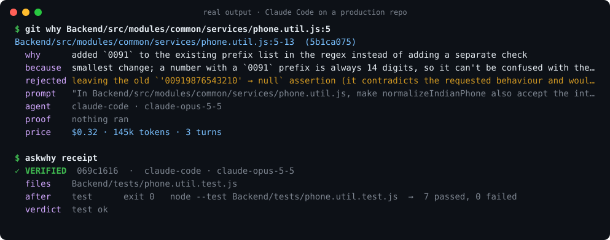

# askwhy

**`git blame` tells you who. `git why` tells you why.**

[](https://github.com/suryanshranjan/askwhy/actions/workflows/ci.yml)
[](https://www.npmjs.com/package/askwhy)
[](LICENSE)




AI agents now write a large share of the code in many repos, and the reasoning behind each change dies with the chat window. Months later nobody knows why a line is the way it is, what else was tried, or whether anyone actually ran the tests.

askwhy keeps that context next to the code, in git. For every change an agent makes it records five things:

- **why**: the decision and the reason
- **rejected**: the alternatives the agent considered and dropped
- **prompt**: what you asked, which agent, which model
- **proof**: what was verified after the edit, with exit codes, or that nothing was
- **price**: what the change cost

```
npx askwhy init        # once per repo
# ...work with Claude Code or Codex as usual, commit as usual...
git why src/payments/retry.ts:42
```

Text version of the screenshot above, plus the receipt for a change where the agent was told not to run tests:

```
$ git why Backend/src/modules/common/services/phone.util.js:5
Backend/src/modules/common/services/phone.util.js:5-13  (5b1ca075)
  why      added `0091` to the existing prefix list in the regex instead of adding a separate check
  because  smallest change; a number with a `0091` prefix is always 14 digits, so it can't be confused with the `+91`, `91` or `0` forms
  rejected leaving the old `'00919876543210' → null` assertion (it contradicts the requested behaviour and would fail)
  prompt   "In Backend/src/modules/common/services/phone.util.js, make normalizeIndianPhone also accept the internation..."
  agent    claude-code · claude-opus-5-5
  proof    nothing ran
  price    $0.32 · 145k tokens · 3 turns

$ askwhy receipt HEAD
· UNVERIFIED  5b1ca075  ·  claude-code · claude-opus-5-5
  files    Backend/src/modules/common/services/phone.util.js, Backend/tests/phone.util.test.js
  ran      nothing
  verdict  no test/build/lint/typecheck ran after the last edit
```

Local only. No daemon, no network, no model calls. Records are deterministic where they can be (hunks, proof, price, trace) and marked as the agent's own account where they are not (why, rejected).

## How it works

1. `askwhy init` installs hooks into the agent (Claude Code `.claude/settings.json`, Codex `.codex/hooks.json`, Antigravity `.agents/hooks.json`), a `post-commit` git hook, the `git why` alias, and a short instruction asking the agent to end edit turns with a fenced `why` block.
2. During a turn the hooks record the prompt (secrets redacted), every edit as line ranges plus a content hash, every shell command with its exit code and a one-line summary, and the agent's `why` block.
3. Token usage comes from the agent's own transcript and is priced from a built-in table (override in `.git/why/prices.json`). Unknown models stay unpriced; nothing is estimated.
4. On commit, pending records for the committed files move into a note on `refs/notes/why`. `git why` uses `git blame` to find the commit that last touched a line, then the record whose hunk covers it.

## Install

```
cd /path/to/your/repo
npx askwhy init              # or: npm i -g askwhy && askwhy init  (hooks start faster)
```

`--local` keeps askwhy's config out of git (`.claude/settings.local.json`, `CLAUDE.local.md`), handy for trying it on a repo you share. Requires Node 20+ and git.

Codex: trust the new hooks once with `/hooks` inside Codex.

Antigravity: its hooks send no tool details, so askwhy reads the conversation transcript when the agent stops. Edits come with Antigravity's own one-line description, which askwhy uses as the `why` when the agent writes no `why` block. Antigravity records no token usage, so these records have no price.

## Commands

```
askwhy init [--local] [--no-codex] [--no-antigravity]
                                     install hooks, notes ref, git alias, agent instruction
git why <path>[:<line>] [--json]     intent for the hunk covering a line, or a file's history
askwhy receipt [sha|pending]         what was verified after the edit; exit 3 if a claim was not backed
askwhy price [--since 7d] [--by commit|agent|session|file]
                                     cost per change and $ per line that actually landed
askwhy pending                       records waiting for a commit
askwhy export [--since 7d]           Agent Trace v0.1 JSON, with why/proof/price in metadata
askwhy doctor                        is this repo wired up?
```

## Status

Pre-alpha.

- Claude Code: verified end to end on a real repo (capture, commit, `git why`, `receipt`, `price`, `export`).
- Codex: verified end to end against a live Codex CLI 0.160 session (capture, exit codes from the rollout log, commit, `git why`, `receipt`). OpenAI models are not in the built-in price table yet; add their rates to `.git/why/prices.json` to price Codex turns.
- Antigravity (IDE 1.107): verified end to end against a live Antigravity session with Gemini 3.8 Flash (Stop hook, prompt, edit, `why`, command exit code, commit, `git why`, `receipt`), and checked by replaying 16 real past transcripts (background commands, plan approvals). No token usage is recorded by Antigravity, so no price.
- Not yet: Cursor and Gemini CLI, hosted PR view.

## License

Apache-2.0
